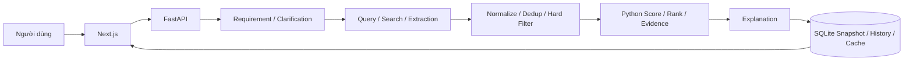

# Smart Shopping AI

**XÂY DỰNG HỆ THỐNG TRỢ LÝ MUA HÀNG THÔNG MINH ỨNG DỤNG TRÍ TUỆ NHÂN TẠO**

Ứng dụng nhận nhu cầu mua hàng bằng tiếng Việt, tìm và chuẩn hóa sản phẩm, lọc theo yêu cầu, chấm điểm bằng Python và giải thích kết quả kèm nguồn. Đây là project đã phát triển các luồng MVP, không còn là skeleton PART 01.

**Demo Mode chạy không cần API key.** Sản phẩm Demo là dữ liệu giả lập, không phải giá hoặc hàng hóa đang bán. Live Mode có adapter OpenAI/Gemini và Tavily; chất lượng dữ liệu phụ thuộc nguồn và cấu hình tài khoản.

## Tính năng

### Research Catalog — Mục tiêu A

Đã tích hợp Amazon Reviews 2023 **lịch sử**, không phải Live: SQLite local có
150 sản phẩm thật, 70 giá tham khảo USD, **0 ProductOffer tạo từ dataset**.
Chọn **Research Catalog** ở trang chủ để tìm catalog, xem thông số/điểm phù hợp,
so sánh và lịch sử. Ví dụ: “phụ kiện điện thoại dưới 50 USD”, “điện tử”.
Ngân sách VND không so với USD; RAM/storage bắt buộc thiếu chứng cứ không được
coi là đạt. Không cần LLM/Tavily key, không fine-tune mô hình.

Phạm vi dữ liệu: nghiên cứu phi thương mại cục bộ, không tái phân phối raw/DB;
dataset không có giấy phép mở rõ ràng. [Đánh giá nguồn](docs/RESEARCH_DATA_SOURCE_ASSESSMENT.md),
[tiến độ R00–R09](docs/RESEARCH_DATA_PROGRESS.md),
[báo cáo và lệnh tái lập](docs/RESEARCH_DATA_INTEGRATION_REPORT.md).
R08 còn thiếu nhãn người đánh giá độc lập: Precision@K/NDCG hiện **N/A**.

`demo` = MOCK_DEMO; `research` = HISTORICAL_RESEARCH. `live` chỉ là luồng truy
cập nguồn hiện hành, **không tự động đồng nghĩa LIVE_VERIFIED**. Research không
bật collector flags hoặc giải quyết thay blocker quyền truy cập crawler.

| Thành phần | Implementation hiện tại |
|---|---|
| Requirement Analyzer / Clarification | Trích category, budget, purpose, brands, tiêu chí/ưu tiên; hỏi bổ sung khi thiếu dữ liệu. Demo parser local; Live thử LLM rồi fallback local. |
| Query Generator | Python tạo query mua hàng từ requirement/source strategy, không gọi LLM. |
| Search Provider | Interface chung; mock offline hoặc Tavily Live với timeout/retry, xử lý lỗi từng query. |
| Extraction / Normalization | Parser deterministic từ search payload; chuẩn hóa tên, category theo evidence, giá VND, rating, review count, specifications. |
| Deduplication / Product / Product Offer | Hợp nhất Product; mỗi merchant/source có offer riêng. Không copy category từ yêu cầu sang sản phẩm. |
| Hard Filter / Scoring / Ranking | Lọc category, budget, brand, exclusion; Python tính 6 điểm thành phần và Top K. Không tạo dữ liệu để đủ K. |
| Structured Requirement Matching | matched / unmet / unknown, requested value, product value, reason. Thiếu dữ liệu không đồng nghĩa đáp ứng hoặc vi phạm. |
| Structured Evidence | Nguồn từng price/rating/review/specification phải được observation của session hỗ trợ. Thiếu nguồn để rỗng. |
| Recommendation Snapshot | Lưu giá, thông số, score, matching, evidence, explanation cùng thời điểm; session cũ không ghép giá mới vào score cũ. |
| AI Explanation | Demo deterministic; Live OpenAI/Gemini với timeout/retry/fallback. LLM không quyết định numerical score. |
| Product detail / Comparison | Detail đọc catalog hiện có. Comparison mới dùng snapshot/legacy view nhất quán; kết luận do Python, không gọi LLM. |
| Feedback / History | Ghi phản hồi và xem lại phiên. History dùng chung database local, chưa có đăng nhập/phân quyền. |
| Cache | SQLite cache theo normalized requirement + config, TTL 1800s, Live-only; copy snapshot, không replay giá vào catalog. |
| Frontend / Browser E2E | Summary, score breakdown, matching/evidence, filter/sort, compare, feedback, history; Playwright chạy Demo local. |
| Marketplace upgrade | Contract typed cho collector, URL Shopee/Lazada trực tiếp, ProductVariant + Offer + PriceObservation, score Product/Offer hai cấp, freshness và cảnh báo so giá khác SKU. Live collector mặc định khóa theo policy. |

AI Match là điểm phù hợp theo quy tắc, không phải xác suất mua đúng. Data Confidence là chỉ số chất lượng/độ đầy đủ dữ liệu riêng, chưa được hiệu chuẩn thống kê. Voice là **NOT REQUIRED FOR MVP**. Xem [final audit](docs/FINAL_AUDIT.md).

## Kiến trúc và stack



- Frontend: Next.js **16.3.3**, React **19.2.8**, TypeScript, Tailwind CSS 4.
- Backend: Python, FastAPI, Pydantic 2, SQLAlchemy 2, SQLite WAL.
- Adapters: OpenAI qua HTTP, Gemini qua `google-genai`, Tavily qua HTTP.
- Tests: pytest, Node test runner/React render, ESLint, Playwright **1.63.0**.
- Đã kiểm tra trên Python **3.13.12**, Node **22.21.1**, Windows, Edge headless. Khuyến nghị Python 3.13 và Node 22; Node tối thiểu 22.6 cho `--experimental-strip-types` của frontend tests.
- Frontend cài bằng lockfile `npm ci`. Backend giữ dependency ranges trong `requirements.txt`, chưa có Python lockfile; lần cài mới có thể nhận patch khác.

## Cấu trúc thực tế

```text
backend/
  app/
    api/routes/       # health, requirements, search, recommendations,
                      # products, comparison, feedback, history
    core/             # config, database, constants
    models/           # 14 bảng SQLAlchemy
    schemas/          # request/response, ranking, matching, evidence
    services/         # llm, search, extraction, normalization, dedup, filter,
                      # scoring, recommendation, validation, cache
    repositories/     # namespace dự phòng; ORM hiện nằm ở route/service
    main.py
  scripts/run_e2e_backend.py
  tests/              # conftest, unit, integration
  requirements.txt  .env.example  Dockerfile
frontend/
  app/                # /, /results/[sessionId], /products/[productId],
                      # /compare/[comparisonId], /history
  components/  lib/  types/  tests/  e2e/
  playwright.config.ts  package.json  package-lock.json  Dockerfile
docs/
.env.example  .dockerignore  docker-compose.yml
```

## Chạy local trên Windows PowerShell

Sau khi clone, mở terminal tại thư mục chứa README này. Không cần activate venv khi gọi trực tiếp Python trong `.venv`.

**Terminal 1 — backend:**

```powershell
cd backend
py -3.13 -m venv .venv
.\.venv\Scripts\python.exe -m pip install -r requirements.txt
Copy-Item .env.example .env
.\.venv\Scripts\python.exe -m uvicorn app.main:app --host 127.0.0.1 --port 8000 --reload
```

Lệnh copy dành cho clone mới, không ghi đè `.env` đã cấu hình. Giữ `DEMO_MODE=true`, API keys rỗng. Startup tự tạo các bảng còn thiếu; không cần tự gọi `init_db()`. URL mặc định tạo `backend/smart_shopping.db`.

Kiểm tra [health](http://127.0.0.1:8000/api/health), [database/Demo status](http://127.0.0.1:8000/api/system/status), [Swagger](http://127.0.0.1:8000/docs).

**Terminal 2 — frontend:**

```powershell
cd frontend
npm.cmd ci
npm.cmd run dev
```

Mở [http://localhost:3000](http://localhost:3000). Browser mặc định gọi `http://127.0.0.1:8000`. Backend cho phép hai origin `localhost:3000` và `127.0.0.1:3000`. Dừng server bằng Ctrl+C.

Frontend production local: chạy `npm.cmd run build`, sau đó `npm.cmd start` từ `frontend/`.

## Environment và Live Mode

| File | Được đọc bởi |
|---|---|
| `backend/.env` | Pydantic khi chạy backend từ `backend/`. Process environment ưu tiên hơn file; restart sau khi đổi. |
| `.env` ở root | Docker Compose interpolation; không tự được backend local đọc khi cwd là `backend/`. |
| `frontend/.env.local` | Next.js; chỉ đặt cấu hình công khai như `NEXT_PUBLIC_API_URL=http://127.0.0.1:8000`. |

Hai `.env.example` không có secret, liệt kê đầy đủ Settings hiện tại. `NEXT_PUBLIC_API_URL` là URL browser truy cập, được nhúng lúc build; đổi nó cần build lại. Không dùng `http://backend:8000` cho browser trên host. [Tài liệu Next.js](https://nextjs.org/docs/app/guides/environment-variables#bundling-environment-variables-for-the-browser).

| Biến backend | Mặc định |
|---|---|
| `APP_ENV` / `DATABASE_URL` | `development` / `sqlite:///./smart_shopping.db` |
| `DEMO_MODE` | `true` |
| `LLM_PROVIDER` / `LLM_FALLBACK_PROVIDER` | `openai` / `gemini` |
| `OPENAI_API_KEY` / `GEMINI_API_KEY` / `TAVILY_API_KEY` | Rỗng |
| `OPENAI_MODEL` / `GEMINI_MODEL` | `gpt-4o-mini` / `gemini-3.6-flash` (chuỗi mặc định trong config; chưa xác minh quyền truy cập model Live) |
| `LLM_TIMEOUT_SECONDS` / `SEARCH_TIMEOUT_SECONDS` | 30 / 15 |
| `LLM_RETRY_COUNT` / `SEARCH_RETRY_COUNT` | 2 / 1 |
| `MAX_SEARCH_QUERIES` / `MAX_RESULTS_PER_QUERY` / `TOP_K` | 4 / 5 / 5 |
| `CACHE_TTL_SECONDS` | 1800; không dương thì vô hiệu hóa cache |
| `PRODUCT_OFFER_FRESHNESS_TTL_SECONDS` | 3600; độc lập với search-result cache |
| `COLLECTOR_MAX_URLS` | 5 URL trực tiếp mỗi request |
| `COLLECTOR_LIVE_ENABLED` / `COLLECTOR_POLICY_CONFIRMED` | `false` / `false`; cả hai chỉ bật khi operator có quyền phù hợp |
| `ENABLE_LLM_EXTRACTION_FALLBACK` | `false`; fallback chỉ nhận specs, không nhận giá/ID/rating/stock |
| `SECRET_KEY` | Placeholder `change-this-before-production`, chưa dùng làm authentication trong MVP |

Live: chủ động đặt `DEMO_MODE=false`, Tavily key và key/model hợp lệ của provider được chọn trong backend env, rồi restart. Chọn model khả dụng trong tài khoản; không coi giá trị mặc định là bảo đảm provider đang cung cấp model đó. Analyzer/explanation có fallback local; search Live thiếu key/lỗi toàn bộ sẽ báo lỗi, không âm thầm biến mock thành dữ liệu Live. Tests không gọi API trả phí.

Collector marketplace là một opt-in riêng với Live search. Điều khoản công khai được rà
soát ngày 2026-10-15 không cung cấp bằng chứng quyền crawl cho repository này, vì vậy
Shopee/Lazada đang ở trạng thái `ACCESS_RESTRICTED`; xem [collector policy](docs/collector-policy.md).
Không bật hai cờ collector nếu chưa có thẩm quyền/đồng ý áp dụng.

Collector nguồn storefront công khai cũng mặc định fail-closed: registry rỗng, chưa có
merchant điện tử nào được duyệt hoặc xác minh Live. WooCommerce Store API và HTTPX/JSON-LD
được kiểm thử offline; xem [crawler runbook](docs/CRAWLER_RUNBOOK.md),
[đánh giá](docs/CRAWLER_EVALUATION.md), [source matrix](docs/CRAWLER_SOURCE_MATRIX.md)
và [tiến độ](docs/CRAWLER_PROGRESS.md). DNS/IP được kiểm tra lại và ghim tại lúc
mở kết nối; registry vẫn fail-closed và không được bật merchant chưa có căn cứ quyền.

Benchmark offline tái lập:

```powershell
cd backend
.\.venv\Scripts\python.exe -B -X utf8 -m benchmarks.run --output ..\docs\benchmark-results
```

Kết quả này là `FIXTURE_TESTED_ONLY`, không phải Live.

Sau khi đã cấu hình một nguồn được phép trong
`COLLECTOR_SOURCE_REGISTRY_JSON` và bật cả hai cờ policy, có thể nạp trước
catalog điện thoại, laptop/máy tính để bàn và tai nghe vào database hiện tại:

```powershell
cd backend
.\.venv\Scripts\python.exe -B -X utf8 -m scripts.ingest_catalog
```

Job này không fine-tune mô hình; nó chuẩn hóa và upsert dữ liệu có bằng chứng
vào chính các bảng mà recommendation đang đọc. Registry rỗng hoặc nguồn bị
chặn sẽ trả lỗi và không tạo dữ liệu giả. Xem tùy chọn `--query`, `--url` và
quy trình phê duyệt nguồn trong [crawler runbook](docs/CRAWLER_RUNBOOK.md).

Với thao tác Live thủ công, ưu tiên CLI có preflight và hard cap:

```powershell
cd backend
.\.venv\Scripts\python.exe -B -X utf8 -m scripts.crawl_products preflight --url "https://APPROVED-HOST/product/example"
.\.venv\Scripts\python.exe -B -X utf8 -m scripts.crawl_products ingest --live --max-products 5 --max-pages 2
```

Crawl4AI là dependency tùy chọn trong `backend/requirements-browser.txt`; xem
runbook trước khi bật `COLLECTOR_BROWSER_ENABLED`.

## Validation

Từ `backend/`:

```powershell
.\.venv\Scripts\python.exe -B -X utf8 -m pytest
```

Từ `frontend/`:

```powershell
npm.cmd test
npm.cmd run lint
npm.cmd run build
npm.cmd run test:e2e
```

Pytest tự dùng database tạm sạch. Playwright tự khởi động Demo backend **18000**, frontend **13000**, không dùng DB thật. Edge được ưu tiên nếu đã cài; nếu không có, cài Chromium bằng `npx.cmd playwright install chromium`. Không chạy E2E cùng Next dev/build khác trong cùng thư mục. Sau E2E, build lại trước `npm start` bình thường vì `.next` đã nhúng URL test. Chi tiết: [testing](docs/testing.md).

## Docker local

Yêu cầu Docker Engine/Desktop chạy Linux containers và Docker Compose v2. **Máy thực hiện Phase 7 không có Docker: NOT RUNTIME VERIFIED.**

Tại root, dùng example để đảm bảo Demo không phụ thuộc `.env` cá nhân:

```powershell
docker compose --env-file .env.example config
docker compose --env-file .env.example build
docker compose --env-file .env.example up -d
Invoke-RestMethod http://127.0.0.1:8000/api/system/status
Invoke-WebRequest http://127.0.0.1:3000 -UseBasicParsing
docker compose --env-file .env.example logs --tail 50
docker compose --env-file .env.example down
```

Mở frontend và thử một [scenario](docs/demo.md). Có thể gộp build/start bằng `docker compose --env-file .env.example up --build -d`. Backend healthcheck dùng database status; frontend chờ backend healthy. Port chỉ publish lên loopback local. Named volume `shopping-data` chứa `/data/smart_shopping.db`; `down` giữ volume. Không bind-mount DB thật và không dùng `down -v` nếu cần giữ dữ liệu.

`.dockerignore` loại env/secrets, database, venv, node_modules, build output và artifacts. Keys chỉ truyền runtime vào backend. Image frontend giữ toolchain Next/TypeScript cho config hiện tại, chưa tối ưu kích thước. Đây là Docker local MVP, không phải public deployment.

## Troubleshooting

| Vấn đề | Cách xử lý |
|---|---|
| PowerShell chặn Activate.ps1/npm.ps1 | Dùng đường dẫn Python `.venv` và `npm.cmd`; không cần đổi execution policy toàn máy. |
| No module named / sai Python | Kiểm tra `where.exe python`; cài qua chính `.venv\Scripts\python.exe -m pip`. |
| Node không hiểu strip-types | Dùng Node 22.6+ (đã test 22.21.1), rồi `npm.cmd ci`. |
| Không có bảng / không mở SQLite | Chạy đúng cwd; startup tạo schema. Parent directory của URL tùy chỉnh phải tồn tại và có quyền ghi. Không xóa DB để chữa lỗi. |
| Database locked | Dừng instance dư ghi cùng DB; WAL/busy timeout đã bật. Tests có DB riêng. |
| Port conflict | Dừng đúng server giữ 8000/3000 hoặc 18000/13000. E2E không reuse server có sẵn. Đổi port frontend còn cần CORS phù hợp. |
| Failed to fetch | Kiểm tra health, API URL của browser, origin 3000; build lại nếu đổi public URL/vừa chạy E2E. |
| Key thiếu/model lỗi | Demo dùng keys rỗng; Live cần đúng provider/model/key và restart. |
| Không có đề xuất | Xem warnings/filter decisions. Top K là tối đa, không tự bịa thêm sản phẩm. |
| Playwright không có Edge | Kiểm tra path Edge Windows; máy khác cài Chromium bằng lệnh trên. |
| E2E kẹt teardown trong sandbox | Chạy terminal local cho phép tạo/dừng process con, không thay bằng server/DB thật. |
| Pytest cache permission warning | Test DB vẫn tách biệt; sửa quyền cache hoặc dùng `-o cache_dir=<thư_mục_có_quyền_ghi>`. |
| Docker không khả dụng | Cài/bật Docker riêng rồi validation; pytest không chứng minh image chạy được. |

## Tài liệu

[Architecture](docs/architecture.md) · [Database](docs/database.md) · [API](docs/api.md) · [Testing](docs/testing.md) · [Crawler runbook](docs/CRAWLER_RUNBOOK.md) · [Crawler evaluation](docs/CRAWLER_EVALUATION.md) · [Demo](docs/demo.md) · [Presentation](docs/presentation.md) · [MASTER_SPEC](docs/MASTER_SPEC.md) · [Final audit](docs/FINAL_AUDIT.md)
