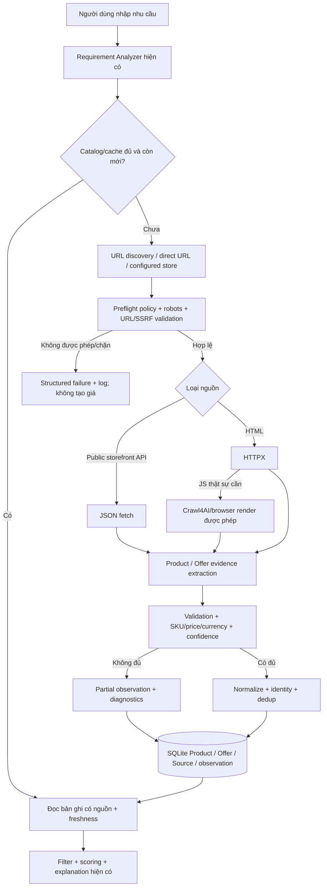

# TASKS.md — Smart Shopping AI | Thu thập & lưu sản phẩm THẬT (Crawler/Collector Track)

> **Dùng cho Codex — phiên bản 2026-10-15.** Đặt tại thư mục gốc của `ThinhLoLem/smart-shopping-ai-part01`. Đây là track tập trung cho **real-product ingestion**: phát hiện nguồn → kiểm tra khả năng truy cập → lấy dữ liệu → chứng thực → chuẩn hóa → lưu DB → làm dữ liệu đầu vào cho recommendation. **Không phải lệnh cam kết crawl được Shopee/Lazada**. API mở, HTML công khai và trình duyệt đều phụ thuộc điều khoản và kiểm soát truy cập của từng website. Không có AI nào bảo đảm vượt được hạn chế truy cập; tuyệt đối không thử vượt chặn.
>
> Nếu repository đã có `TASKS.md` khác, **gộp task và giữ lịch sử**; không xóa/ghi đè tiến độ cũ. Ưu tiên checklist này cho phần crawler, rồi quay lại các mục recommendation/UI ngoài phạm vi.

## 0. Quy tắc vận hành của Codex

- [x] Mở repository, xem `git status`, README, `docs/architecture.md`, `docs/database.md`, `docs/testing.md`, các tests và toàn bộ pipeline hiện tại. Không mặc định repo vẫn giống ảnh chụp trước đây.
- [x] Lập bản đồ file/dòng dữ liệu hiện hữu và danh sách khoảng trống thực sự. **Không xây mới một hệ thống song song** nếu module có thể tái sử dụng.
- [x] Xử lý task theo thứ tự phụ thuộc T00 → T10. Sau mỗi task cập nhật `[ ]` thành `[x]` **chỉ khi DoD đạt**, ghi lệnh test và bằng chứng vào `docs/CRAWLER_PROGRESS.md`.
- [x] Mỗi task ghi trạng thái `TODO | IN_PROGRESS | DONE | BLOCKED`, thời gian, bằng chứng và blocker; có thể tiếp tục từ checkpoint ở phiên Codex tiếp theo. Không tự dừng ở bước viết kế hoạch; triển khai code.
- [x] Không tự ý push, force-push, reset hoặc xóa dữ liệu người dùng. Tạo nhánh riêng nếu làm trên máy local; không tự commit nếu môi trường/chính sách không cho phép.
- [x] Mọi unit/integration test phải **offline**, không có request trả phí hay vào website ngoài. Live smoke test **opt-in**, luôn giới hạn số URL và phải qua preflight.
- [x] Dùng model AI để phân tích text khó; **không dùng AI tạo giá, SKU, tồn kho, rating hoặc nguồn**. Dữ liệu thiếu là `null/unknown`.
- [x] Luôn công khai các trạng thái `VERIFIED_LIVE`, `PARTIAL`, `STALE`, `ACCESS_RESTRICTED`, `ROBOTS_DISALLOWED`, `SOURCE_NOT_PERMITTED`, `FETCH_ERROR`, `NOT_TESTED_LIVE` theo ngữ nghĩa đã định nghĩa. Không gọi fixture/test mock là live.
- [x] Không sử dụng endpoint nội bộ trái phép, token/cookie đánh cắp, proxy xoay vòng né chặn, CAPTCHA solver, fingerprint/stealth để vô hiệu biện pháp bảo vệ, hay khai thác vùng cần đăng nhập.

## 1. Phạm vi và nguồn thực tế

### Phải hỗ trợ các đường lấy dữ liệu

| Thứ tự | Nguồn | Điều kiện | Kết quả |
|---|---|---|---|
| 1 | **Storefront API công khai được phép**, ví dụ WooCommerce Store API | Website thực có endpoint đọc sản phẩm, điều khoản phù hợp | JSON sản phẩm/giá/shop thực |
| 2 | **Trang sản phẩm công khai** | URL hợp lệ, được phép tự động truy cập | HTML, JSON-LD Product/Offer, OG/meta |
| 3 | **Crawl4AI (self-hosted, browser render)** | Đã qua preflight; `httpx` không đủ vì JavaScript | DOM/HTML đã render, không vượt bảo vệ |
| 4 | **LLM structured extraction** (cấu hình OpenAI/Gemini/Ollama, *tùy chọn*) | Đã có nội dung web được phép lấy nhưng thông số phi cấu trúc | Thông số/bằng chứng cần xác minh lại |
| 5 | **Tavily discovery hiện có** | Có key và đúng chính sách nguồn | URL ứng viên, KHÔNG phải giá đã kiểm chứng |

- **Shopee/Lazada**: chỉ thử sau khi kiểm tra quyền truy cập/điều khoản; nếu chặn bot, CAPTCHA hoặc yêu cầu đăng nhập: báo `ACCESS_RESTRICTED` và chuyển nguồn khác. Không được lấy việc hỗ trợ hai sàn làm điều kiện hoàn thành track crawler.
- **Nguồn thay thế tối thiểu**: chọn một cửa hàng thật, sản phẩm điện tử nếu tìm được, có Store API hoặc HTML sản phẩm công khai và *được phép thu thập*. Không tự bịa danh sách cửa hàng. Nếu không xác minh được quyền/khả năng dùng dữ liệu, ghi BLOCKED; fixture vẫn có thể dùng để hoàn thiện code nhưng không được báo LIVE.
- **Không ngụy tạo tính thời gian thực**: tất cả giá hiển thị phải có `observed_at`, `currency`, trạng thái `freshness`; phí vận chuyển/voucher theo tài khoản không được coi là giá chung.

### Luồng đích



## 2. Hiện trạng repo phải tái sử dụng

Đối chiếu trực tiếp thay vì giả định đường dẫn bất biến:

- `backend/app/services/search/search_service.py`, `base.py`, `tavily_provider.py`, `progressive_retrieval.py`, `source_filter.py`.
- `backend/app/services/extraction/product_page_validator.py`, `product_extraction_service.py`, `dealer_offers.py`.
- `backend/app/services/normalization/*`, `services/dedup/product_deduplicator.py`.
- `backend/app/models/product.py`, `product_offer.py`, `source.py`, `raw_product_candidate.py`, `recommendation_snapshot.py`.
- `backend/app/services/recommendation/candidate_builder.py`, `recommendation_service.py` và các validation/scoring.
- `backend/app/core/config.py`, `core/database.py`, `backend/tests/unit` và `backend/tests/integration`.

**Các lưu ý từ lần rà soát ban đầu** (phải kiểm tra lại):
- `Source` hiện nhận URL/host/reliability, `ProductOffer` có `product_id`, `source_id`, `merchant`, `price`, `currency`, `availability`, `last_checked_at`.
- `RawProductCandidate` gắn với `SearchSession`, vì thế ingestion định kỳ không được bịa `session_id`; thiết kế staging/observation riêng nếu cần.
- CandidateBuilder hiện tập hợp nhiều offers cho một canonical product và yêu cầu session-specific evidence. Tránh phá vỡ mối quan hệ này.
- Dữ liệu Demo không được tự động xuất hiện trong Live; test không cần key.

---

## T00 — Baseline, guardrail, source feasibility (P0) — DONE

**Phụ thuộc:** không có.

- [x] `git status` và ghi các thay đổi chưa commit; không overwrite.
- [x] Chạy baseline backend tests; frontend tests/lint/build nếu có môi trường; lưu pass/fail/không chạy được.
- [x] Đọc config & map call graph: requirement → search → extraction → DB → recommendation; xác nhận hợp đồng Pydantic/ORM hiện tại.
- [x] Lập `docs/CRAWLER_SOURCE_MATRIX.md` với từng nguồn dự kiến: domain, loại API/HTML, URL sản phẩm đại diện (không ghi fake như real), điều khoản/robots checked date, rate limit, key/auth requirement, mẫu price/SKU, quyền sử dụng, lỗi quan sát.
- [x] Kiểm tra *ít nhất một* nguồn sản phẩm điện tử thật nếu có thể, ưu tiên công khai và được phép; không gán nhãn VERIFIED nếu chưa gọi thật.
- [x] Viết ADR ngắn về thứ tự API → HTTPX → Crawl4AI → LLM; giải thích tại sao không phụ thuộc độc quyền Shopee/Lazada.

**DoD:** baseline + source matrix + sơ đồ tích hợp + blockers đã lưu. Nếu không có nguồn hợp lệ, vẫn DONE cho khảo sát, nhưng trạng thái LIVE là BLOCKED.

## T01 — Core contracts & nguồn cấu hình (P0) — DONE

**Phụ thuộc:** T00.

- [x] Thêm cấu trúc `DiscoveredProductURL`, `CrawlAttempt`, `ProductObservation`, `PriceEvidence`, `VariantEvidence`, `CollectorResult` theo Pydantic hoặc dataclasses phù hợp.
- [x] `CollectorResult` luôn có `status`, `source_url`, `platform`, `attempted_at`, `observed_at?`, `error_code?`, `message?`, `evidence[]`, `products[]`.
- [x] Phân biệt *URL discovery result* với *directly verified product observation*; không điền `page_validation.product_page_valid=True` giả.
- [x] Định danh: `platform + external_product_id + external_variant_id + merchant/source` khi có; fallback canonical URL đã chuẩn hóa và bằng chứng; không tự gộp các biến thể mơ hồ.
- [x] Monetary types phải giữ giá trị, `currency`, precision (Decimal/minor units nếu cần), các trường `listed_price`, `sale_price`, `price_range` riêng; VND phải nhất quán với schema integer hiện tại.
- [x] `SOURCE_TYPE`/mode phân biệt `mock`, `sample_api`, `verified_public_api`, `verified_product_page`, `unverified_snippet`, `stale`; không nhầm mô phỏng với Live.
- [x] Thêm config typed cho allowed domains, concurrency, per-domain pacing, max pages, max bytes, timeouts, browser toggle, LLM toggle, source preferences và freshness TTL. Mặc định tắt live crawling.

**DoD:** schemas ổn định, unit tests đảm bảo không coi snippet/mock là verified; Demo vẫn chạy.

## T02 — Preflight & HTTP safety (P0) — DONE

**Phụ thuộc:** T01.

- [x] Validate URL scheme `http/https`, host allowlist đúng subdomain, port policy, username/password, canonical redirects.
- [x] Ngăn SSRF: loopback, private/reserved/link-local/metadata IP, DNS rebind/redirect đến IP bị cấm, IDN/punycode bất thường, quá nhiều redirect; áp dụng cả API và browser fetch. *(HTTPX kiểm tra DNS tại `connect_tcp`, ghim socket vào IP đã kiểm tra; browser dùng CONNECT proxy ghim IP và route allowlist.)*
- [x] Robots policy checker có cache, User-Agent nhận dạng, `SOURCE_NOT_PERMITTED` khi terms/policy không cho; `ROBOTS_DISALLOWED` cho robots; mặc định *fail closed* khi chính sách không chắc chắn.
- [x] Ghi `robots_checked_at`, `terms_checked_at`, `permission_basis`/configured source registry; không giả định public=free-for-all.
- [x] Per-host concurrency mặc định 1, delay cấu hình bảo thủ; retry 5xx/timeout giới hạn; 429 tôn trọng Retry-After và ngừng; 401/403/CAPTCHA ngừng, không đổi browser để né chặn.
- [x] Response size/MIME cap, HTML parser safety, network deadlines, bounded URL queue, closed resources; không cho crawler đi theo link tùy ý.

**DoD:** tests SSRF (URL trực tiếp, redirect, DNS), timeout, 403/429/CAPTCHA, robots và fail-closed pass.

## T03 — PublicStorefrontAPICollector (P0) — DONE

**Phụ thuộc:** T02.

- [x] Tạo collector WooCommerce Store API hoặc nguồn JSON storefront công khai tương đương, **chỉ bật cho host trong Source Registry đã được phê duyệt**.
- [x] Hỗ trợ product list/search, paging với hard caps, product detail, phân loại product vs variant; bám tài liệu chính thức: `https://developer.woocommerce.com/docs/apis/store-api/resources-endpoints/products/`.
- [x] Parse `prices.price` theo `currency_minor_unit`, `currency_code`; không đoán VND/USD; kiểm tra giá min/max/biến thể của WooCommerce (đừng coi giá range là SKU confirmed).
- [x] Ghi shop/domain, product id, permalink, SKU thực, hình ảnh, stock, currency, observed time, traceable JSON path cho price/name.
- [x] HTTP mock fixtures và tests pagination, non-2xx, malformed JSON, empty, product variants, repeated records, price units.
- [x] Nếu không có shop Live hợp lệ: triển khai adapter và tests offline, đánh dấu Live `NOT_TESTED_LIVE` hoặc `BLOCKED`, không tạo URL/shop tưởng tượng.

**DoD:** API connector có test, trả đúng ProductObservation; có ít nhất một thử nghiệm Live hợp lệ nếu điều kiện cho phép, và lưu kết quả riêng.

## T04 — Public Product Page Collector (P0) — DONE

**Phụ thuộc:** T02; song song T03 được.

- [x] Tái sử dụng Tavily/provider hiện có chỉ để discover URL ứng viên; hỗ trợ URL sản phẩm do người dùng nhập và domain allowlist.
- [x] Dùng `httpx.AsyncClient` truy cập HTML công khai; trích JSON-LD `Product`, `Offer`, `AggregateOffer`, `ItemList`, `@graph` thận trọng; OG/title chỉ phụ trợ.
- [x] Phát hiện trang danh mục/blog/review/rental/aggregate search, trả `NOT_PRODUCT_PAGE` thay vì gán giá giả.
- [x] Tái sử dụng `product_page_validator.py`/`dealer_offers.py`; bảo đảm price/identity/source same-page validation.
- [x] Khả năng không lấy được giá hoặc SKU phải trả `PARTIAL`/`UNKNOWN`, không copy số trong snippet/search result.
- [x] Không crawl theo link ngoài domain allowlist hoặc theo link checkout/đăng nhập.

**DoD:** fixture JSON-LD (trực tiếp, @graph, nhiều offers, range, không có price) pass; có nguồn/URL cho mọi trường cần dùng.

## T05 — Crawl4AI browser fallback (P0) — DONE

**Phụ thuộc:** T04.

- [x] Thêm Crawl4AI **self-hosted** là dependency *optional*, gắn với một renderer interface, không ép mọi cài đặt phải chạy browser. Kiểm tra phiên bản tương thích Python/OS và pin version thử nghiệm.
- [x] Ưu tiên parser JSON-LD/CSS/XPath trước LLM; chỉ kích hoạt browser khi xác định trang cần JS và truy cập vẫn được phép.
- [x] Browser timeout, max navigation/pages, max DOM bytes, memory/process bounded, context cleanup; không click mua hàng, đăng nhập hay tải file tùy tiện. *(Chromium sandbox, local CONNECT egress proxy, host pinning, Playwright route guard, process/RSS watchdog và browser flags đều bật.)*
- [x] Không dùng Crawl4AI như đường vòng sau `403/429/CAPTCHA/ROBOTS_DISALLOWED`.
- [x] Đưa DOM đã render về cùng ProductPageValidator/normalizer, không tạo hai nguồn truth khác nhau.
- [x] Tests dùng renderer fake/static fixture; optional smoke test trên domain hợp lệ có JavaScript. *(Live smoke 2026-10-16 trên scraping sandbox `quotes.toscrape.com/js/`: HTTP 200, JS DOM verified, 8,985 bytes, 2,641 ms.)*

**DoD:** renderer chạy được khi cài optional dependency; khi thiếu dependency báo `BROWSER_UNAVAILABLE` có hướng dẫn, không crash luồng API/HTTP.

## T06 — Optional AI extraction fallback (P1) — DONE

**Phụ thuộc:** T04 hoặc T05.

- [x] Tái sử dụng LLM layer hiện có; không ép buộc thêm model/paid key mới. Cho phép chọn model có structured JSON output đang khả dụng qua config.
- [x] Chỉ gửi vùng HTML/markdown đã lọc liên quan `Product` và `Specifications` (giới hạn tokens và loại HTML nguy hiểm); lưu provenance từng trường.
- [x] Dùng Pydantic/JSON Schema bắt model trích xuất `brand/model/specifications`, kèm quote/selector/source location nếu có; xác minh lại với nội dung gốc.
- [x] **LLM tuyệt đối không chốt giá/stock/SKU/voucher/ship nếu không có evidence và xác nhận deterministic**. Reject unsupported claims.
- [x] Chống prompt injection từ nội dung trang (chỉ coi là dữ liệu); có cache, timeout, cost bounds, deterministic fallback.
- [x] Benchmark có/không LLM trên *cùng fixtures*, ghi thêm latency/cost và precision. *(Offline simulated structured output; không phải provider benchmark.)*

**DoD:** mock LLM trả thông số sai hoặc làm giả giá bị chặn; khi thiếu key pipeline vẫn hoạt động.

## T07 — Normalize, deduplicate, idempotent persistence (P0) — DONE

**Phụ thuộc:** T03/T04 và T01.

- [x] Tái sử dụng `NormalizationService`, `ProductDeduplicator`, `Product`, `ProductOffer`, `Source`, `RawProductCandidate`.
- [x] Kiểm tra schema hiện có; chỉ thêm bảng/cột cần thiết (ví dụ `ProductVariant`, `PriceObservation`, `CrawlRun`, `SourcePermission`), làm migration **an toàn với SQLite** bằng công cụ/chiến lược phù hợp; không coi `create_all()` là migration cột cũ.
- [x] `RawProductCandidate` đang cần `session_id` thật: với on-demand gắn session hiện có; với refresh định kỳ tạo data model riêng nếu cần, tuyệt đối không tạo session giả để lách FK.
- [x] Dedup canonical Product riêng, Variant riêng nếu nhiều SKU, Offer riêng theo shop/source/SKU; không gộp khác màu/dung lượng/trạng thái hàng.
- [x] Mỗi price observation lưu amount/currency/observed_at/source_url/identity; không overwrite lịch sử. Chỉ cập nhật current price khi evidence verified hơn hoặc mới hơn theo rule minh bạch.
- [x] UNIQUE/index phù hợp, transactional upsert; repeated ingestion không tăng số bản ghi product/variant/offer; price history ghi theo thay đổi hoặc sampling policy minh bạch.
- [x] Không biến fetch failure thành out-of-stock. Cảnh báo stale với last successful observation, không ghi đè giá khi crawl thất bại.
- [x] Migrations/tests: clean DB, nâng cấp DB schema cũ bản sao, repeated import, rollback/duplicate/concurrency, snapshot bất biến.

**DoD:** lấy cùng URL 2 lần không trùng entity; giữ được 2 offers từ 2 shop; snapshot cũ không đổi sau update giá.

## T08 — On-demand integration + catalog reuse (P0) — DONE

**Phụ thuộc:** T07.

- [x] Thêm `SourceRegistry`/`CollectorManager` nối vào *luồng search/recommendation hiện có*, hạn chế sửa Recommendation Engine ngoài interface ingest.
- [x] Input: requirement tiếng Việt, URL trực tiếp hoặc configured permitted storefront; lấy từ DB nếu còn mới; nếu thiếu có thể fetch bổ sung và cho thấy tiến độ/trạng thái.
- [x] Tạo `source_preference`/`data_mode` rõ ràng: mock, Tavily, real-collector. Khi real bị lỗi không fallback ngầm sang fake.
- [x] Chỉ đưa candidate verified/partial có nhãn rõ vào ranking; giữ `unknown` requirement matching và currency compatibility.
- [x] Chặn USD giá từ API khác so trực tiếp với ngân sách VND; không dùng tỷ giá ước lượng không được cấu hình.
- [x] APIs hỗ trợ lấy crawl status, evidence, freshness, error; giữ backward compatibility frontend nếu có thể.
- [x] Flow end-to-end: Requirement → discovery → fetch → extraction → normalize → SQLite → `CandidateBuilder` → score/rank → snapshot. Chứng minh bằng integration test và trace thật/mocked được phân biệt.

**DoD:** một search dùng data ingress thực, database có Product/Offer, recommender nhận đúng observation; test cũ không regression.

## T09 — Kiểm thử thực nghiệm / benchmark (P0) — IN_PROGRESS

**Phụ thuộc:** T03–T08.

- [x] Unit: source-registry, preflight, JSON API, HTML/JSON-LD, renderer fallback, LLM guardrail, variants, currency, upsert, stale, retry, source failure.
- [x] Integration: query → collector → DB → recommendation; mock-only mode độc lập internet; 403/429/timeout không làm mất snapshot cũ.
- [ ] Live smoke riêng với `--live --max-products 5 --max-pages 2`, preflight và allowlist; sau chạy lưu **nguồn + timestamp + kết quả đã khử bí mật**. Không tự thực hiện live trong CI.
- [x] Tạo `backend/scripts/crawler_benchmark.py` hoặc CLI tương tự: dataset URL có provenance, ground truth gán nhãn thủ công; xuất CSV/JSON, không hard-code kết quả.
- [x] Metrics: `fetch_success_rate`, `product_page_verified_rate`, `field_precision_by_name_price_sku`, `price_evidence_coverage`, `completeness`, `dedup_precision`, `p50/p95_latency`, `save_success_rate`, số URL `restricted/unknown/stale`. **Luôn có mẫu số rõ ràng** và báo riêng theo nguồn.
- [ ] Mục tiêu thí điểm: 20–50 URL từ các nguồn được phép (nếu có); nếu không đủ, báo chính xác số có thật và giới hạn, không tạo thành tích.
- [ ] Ablation `HTTPX vs Crawl4AI vs Crawl4AI+LLM` cùng URL/điều kiện; so sánh phần tăng chất lượng với chi phí/latency.
- [ ] Đánh dấu `VERIFIED_LIVE` **chỉ khi** request thành công từ website thật đã kiểm tra, ít nhất 1 `Product` + 1 `Offer` lưu thành công, price/identity có bằng chứng và runnable reproduction. Số sản phẩm thực tế phải được ghi rõ; không suy rộng thành 'mọi website'.

**DoD:** lệnh offline tests pass, live status trung thực, benchmark script chạy được, báo cáo kết quả có bằng chứng hoặc `N/A`.

## T10 — Dokumentation, runbook & bàn giao (P0) — DONE

**Phụ thuộc:** T09.

- [x] Cập nhật `README.md`, `.env.example` (không chứa secret), `docs/architecture.md`, `docs/database.md`, `docs/testing.md`.
- [x] Tạo `docs/CRAWLER_RUNBOOK.md`: cấu hình Source Registry/permission, install optional Crawl4AI, script preflight, sample fetch, ingest, cách đọc status, khôi phục lỗi, demo screenshots/commands.
- [x] Tạo `docs/CRAWLER_EVALUATION.md`: dataset, các nguồn, phương pháp ground truth, bảng metrics có số liệu THỰC hoặc N/A, limitations.
- [x] Tạo hoặc cập nhật `docs/CRAWLER_PROGRESS.md` và checklist T00–T10 với trạng thái, file thay đổi, lệnh chạy, pass/fail, blocker, test evidence.
- [x] Có hướng dẫn chạy một *happy path* với nguồn thực được phép truy cập, hoặc ghi rõ tại sao Live bị BLOCKED/NOT_VERIFIED; có path fixture offline thay thế cho demo kỹ thuật.
- [x] Chạy full backend pytest, frontend tests/lint/build và browser E2E khi khả thi. Không được ghi PASS nếu không chạy. Nếu môi trường thiếu Playwright/browser Docker/key, ghi rõ.
- [x] Chỉ đánh dấu DONE task đã thỏa DoD; có ghi chú những phần không thể kiểm chứng.

**DoD:** người khác clone repo, chạy hướng dẫn và tái lập các bài test mà không cần hỏi tác giả; báo cáo đầy đủ giới hạn thực tế.

---

## 3. Bảng nghiệm thu tổng hợp

| Điều kiện | Bắt buộc? | Bằng chứng cần ghi |
|---|---|---|
| Không phá Demo/Tavily/Scoring cũ | Có | `pytest`, frontend test, E2E |
| Có collector API storefront thật theo chuẩn | Có | Test mocked JSON, source-registry |
| Có HTML/JSON-LD parser và validator | Có | HTML fixtures, field evidence |
| Crawl4AI browser fallback tùy chọn | Có | Renderer test, runtime optional setup |
| AI extraction chỉ là optional fallback | Có | Test hallucination guardrail |
| Bảo vệ URL/robots/terms/rate limits | Có | Negative unit/integration tests |
| Có persisted offers + nguồn + observed_at | Có | SQLite inspection/integration |
| Re-ingest không gây trùng | Có | Test idempotency |
| Search người dùng nối tới recommendation | Có | End-to-end integration |
| Fetch được Shopee/Lazada không cần phép | **Không thể bảo đảm / không là gate** | Trạng thái thực tế mỗi nguồn |
| Có tối thiểu một nguồn real products verified | Mục tiêu Live; nếu blocker phải báo | URL shop thật, record/evidence, thời gian, mã test |
| Có báo cáo benchmark trung thực | Có | CSV/JSON + ground truth hoặc N/A |

### Trạng thái nghiệm thu

- `OFFLINE_TESTED`: test với mock/fixtures, chưa nói gì về Live.
- `LIVE_VERIFIED`: ít nhất một nguồn công khai được phép, URL/response thật, record verified lưu vào DB và có hướng dẫn tái lập.
- `LIVE_PARTIAL`: truy cập được nguồn thật nhưng thiếu bằng chứng giá/SKU hoặc một số trường.
- `LIVE_RESTRICTED`: nguồn hạn chế (403/429/CAPTCHA/robots/terms), dừng và ghi rõ.
- `LIVE_NOT_VERIFIED`: chưa được thử thành công vì mạng/môi trường/thiếu nguồn được phép.

## 4. Lệnh kỳ vọng (Codex phải tạo đúng CLI hoặc cập nhật theo project)

> Đây là giao diện CLI **đích**, không khẳng định repo hiện đã có. Codex được đổi tên file/argument nếu thuận kiến trúc, nhưng phải cập nhật runbook.

```bash
# Từ backend/ (chỉ ví dụ; các script chưa tồn tại)
python -m pytest
python scripts/crawl_products.py preflight --url "https://SHOP-THAT-IS-PERMITTED.example/product"
python scripts/crawl_products.py ingest --url "https://SHOP-THAT-IS-PERMITTED.example/product" --live --max-products 1
python scripts/crawler_benchmark.py --dataset tests/fixtures/product_url_dataset.json
```

Các URL `.example` là placeholder, tuyệt đối không báo là sản phẩm/nguồn Live.

## 5. Mẫu nhật ký tiến độ cho mỗi task

```text
[T04] STATUS: TODO | IN_PROGRESS | DONE | BLOCKED
Modified files:
Tests run + exact command:
Observed result / source evidence:
Live status (if applicable):
Known limitations:
Next task:
```

## 6. Báo cáo Codex sau mỗi checkpoint

Trả lời ngắn bằng tiếng Việt: `Đã làm` / `Đã kiểm thử` / `Live đã xác minh?` / `Chưa làm hoặc bị chặn` / `Bước tiếp theo`. Phải chỉ rõ số URL sản phẩm thật được đọc thành công, số sản phẩm/offer được lưu, lỗi và denominator. Không tự tạo số liệu.

**Definition of Done cuối cùng:** pipeline dùng được với **nguồn sản phẩm thật được phép truy cập**, lưu bằng chứng có thể truy xuất, trả kết quả về recommendation và có bộ test tái lập; đồng thời không hứa hẹn khả năng thu thập từ các sàn chống bot mà không có quyền.
