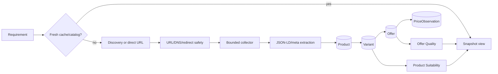
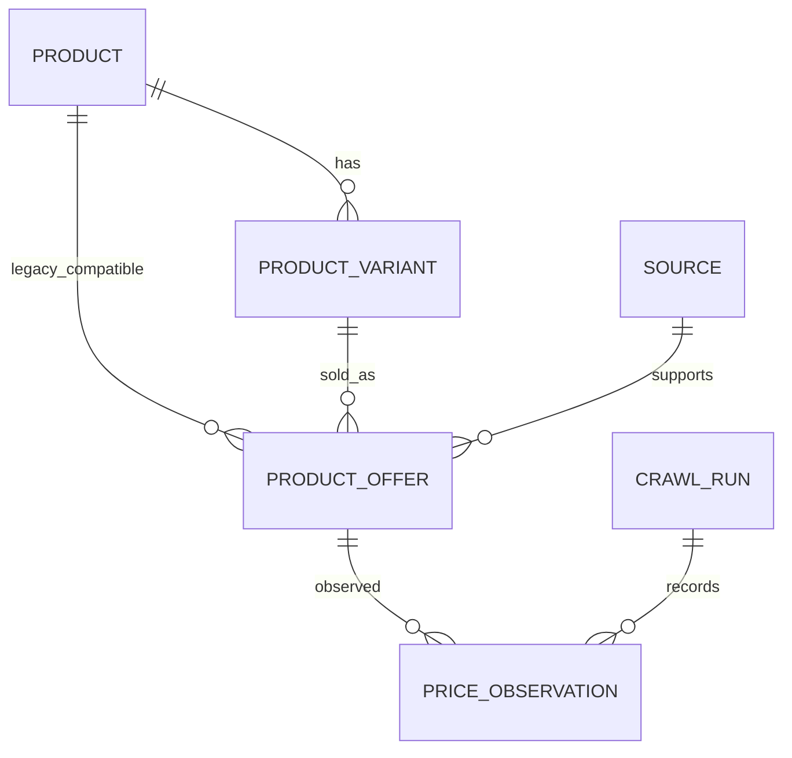

# Crawler & Recommendation Upgrade Report

Date: 2026-10-15 (Asia/Saigon)

## Outcome and boundaries

The existing FastAPI/SQLAlchemy/Next.js architecture was extended rather than rewritten.
Legacy endpoints, the six-component score, Demo Mode, search cache and immutable snapshot
read path remain available. The upgrade adds typed marketplace observations, explicit
Product/Variant/Offer identity, price history, compliant direct-URL collection, two-level
scoring, SKU-safe comparison, UI provenance and an offline benchmark.

No paid API was called. No product-page Live smoke was attempted. Shopee and Lazada are
`ACCESS_RESTRICTED` because their published terms restrict automated collection without
applicable permission and no written permission is present in this repository. Collector
fixtures are `FIXTURE_TESTED_ONLY`, never `LIVE_VERIFIED`.

## Before / after

| Area | Before | After |
|---|---|---|
| Identity | Product + merchant offer | Product → configuration Variant → platform/shop/SKU Offer |
| Price | mutable current offer price | typed listed/sale/range + immutable PriceObservation |
| Collection | Tavily/generic page recovery | separate discovery and bounded Shopee/Lazada direct collector |
| Freshness | search-cache TTL | independent offer-freshness TTL and FRESH/STALE/UNKNOWN |
| Ranking | legacy product score with early best offer | legacy preserved + two-level product/offer scores and ranked shop choices |
| Comparison | one mixed table | Product and Offer sections; `NOT_COMPARABLE` across SKU/model/price type/currency |
| Evaluation | application tests | versioned offline fixtures, denominators, JSON/CSV/Markdown report |

## Architecture



## ERD



All new offer columns are nullable except `freshness_status` with the compatibility default
`UNKNOWN`. The SQLite migration is additive and idempotent. Legacy snapshots are JSON and
are not backfilled or recomputed.

## Collection and security

The URL layer accepts HTTP(S) only, exact marketplace suffixes, public DNS results and
same-platform redirects. It rejects credentials, unexpected ports, private/loopback/link-
local addresses, unsafe redirects and excessive redirects. Responses are streamed with a
2 MB cap and HTML content-type check. Per-domain concurrency/start-rate controls, finite
timeouts, cleanup and a restriction circuit breaker are applied. 401/403/429/CAPTCHA is
`ACCESS_RESTRICTED`; it is never “no products.”

Live collection ships disabled and requires two explicit flags after operator policy
confirmation. There is no CAPTCHA solving, authentication automation, undocumented API,
proxy rotation or fingerprint bypass.

The final security review also confirmed that raw marketplace HTML is parsed as data and
is never rendered or promoted into an AI instruction; React retains its normal escaping.
The optional spec-only LLM path labels page text as untrusted, uses a strict schema and
bounded input/output. Repository secret-pattern scanning found no committed credential.
Application logs do not include request bodies, cookies or authorization values. Request
URL counts, response bytes, timeouts, concurrency and redirect count are bounded, and
owned HTTP clients are closed in `finally` blocks. Deployment-wide API authentication and
rate limiting remain an explicit production limitation.

`npm audit` after upgrading Next.js to 16.4.1 and overriding `source-map-js` to 1.2.2
reports 0 production vulnerabilities; 5 high findings remain only in the development
lint/transitive graph (`eslint-config-next` and glob/parser dependencies). npm's suggested
automatic fix downgrades the Next lint config to 14.x, so it was not applied. The direct
Next.js critical advisories and production source-map advisory are resolved.

## Scoring

Legacy score is unchanged:

```text
budget*.25 + requirement*.30 + purpose*.20 + rating*.10 + review*.05 + source*.10
```

`two-level-v1` Product Suitability uses requirements 50%, purpose 30%, budget 20%. Offer
Quality balanced mode uses price 30%, availability 15%, freshness 15%, source reliability
15%, seller trust 10%, shipping 7.5% and warranty 7.5%. Price-first and trusted-seller modes use versioned alternative
weights. Missing evidence receives no points; confidence and `insufficient_evidence` are
separate. Seller trust is not copied into canonical product quality.

## Main files changed

- `backend/app/schemas/collector.py`
- `backend/app/models/{product_variant,price_observation,crawl_run}.py`
- `backend/app/services/collectors/*`
- `backend/app/services/scoring/two_level.py`
- search/normalization/recommendation/comparison additive integration
- frontend search controls, cards, refresh and split comparison
- `backend/benchmarks/*`, offline tests and generated `docs/benchmark-results/*`

## Validation and benchmark

The final command results are recorded in `TASKS.md`; baseline before feature edits was
844/844 backend tests, 41/41 frontend tests, lint/build pass. The final independent backend
run passed 861 tests with one third-party deprecation warning. Frontend passed 44 tests,
lint and production build. All 15 Playwright assertions passed in 47.1 seconds, including
Demo/history and legacy snapshot flows. E2E now uses an explicit global setup/teardown that
owns and terminates the Python/Next process tree on Windows, so the command exits cleanly.

The committed benchmark uses three synthetic extraction fixtures and one synthetic,
manually labeled ranking case. It performs zero network calls. See
`benchmark-results/report.json`; unavailable metrics retain denominator 0/null and Live is
N/A. These small fixture accuracies are regression signals, not marketplace accuracy.

## Operations and limitations

Back up SQLite (database plus WAL/SHM, or `.backup`) before upgrade. Demo requires no keys.
Direct marketplace collection requires policy authority plus opt-in flags. General HTML
coverage remains conservative; optional LLM fallback is off and can add only validated
technical specs, never price/identity/rating/stock/URL. Shipping, vouchers, warranties and
seller trust remain unknown when evidence is absent. There is no claim of 100-URL Live
coverage, production auth/rate limiting, or public-deployment readiness.

For a future safe Live smoke, first obtain and record permission for each marketplace,
review current terms/robots directives, back up the database, set both collector opt-in
flags, and test one public product URL at low rate. Never use credentials, CAPTCHA bypass,
proxy rotation or undocumented APIs. Record each source independently as `LIVE_VERIFIED`,
`ACCESS_RESTRICTED` or `LIVE_NOT_VERIFIED`, then turn the flags off again.
