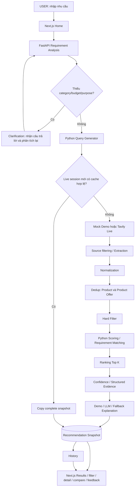

# Architecture

## Historical Research Catalog (2026-10-17)

Research là adapter độc lập, không gọi CachedSearchService/Tavily/crawler/LLM:
native JSONL local → bounded importer → Product + ResearchProduct + HistoricalPriceReference
→ `/api/research/search` → matcher/hard filter/rank → RecommendationSnapshot
→ GET search/history/detail/comparison hiện có → UI nhãn HISTORICAL_RESEARCH.

Luồng cũ giữ nguyên. ProductDeduplicator của Demo/Live không merge research IDs.
Research snapshot là phiên bất biến; refresh bằng Live trả 409, truy vấn mới tạo
session mới. Revision mới tạo identity mới, không overwrite provenance cũ.

`research-v1` chỉ có điểm phù hợp sản phẩm. Trọng số cơ sở: requirements=.60,
rating=.25, review volume=.05, historical USD budget=.10; chỉ chuẩn hóa lại
trên tiêu chí áp dụng. Unknown requirement nhận 0, không thành matched; priority=5
phải matched mới qua lọc. Không yêu cầu specs thì bỏ thành phần requirements;
ngân sách không USD thì bỏ budget với warning. Rating thiếu nhận 0. OfferScore
= NULL, không cộng seller/source/shipping/stock. Confidence là độ đầy đủ metadata,
không xác suất chính xác. Purpose chưa chứng minh được không được cộng điểm.

Parser local hỗ trợ danh mục Việt/Anh, vài brand/keyword, RAM/storage/camera có
đơn vị và ngân sách số nguyên. Không phải NLP tổng quát; ngân sách thập phân
bị từ chối thay vì parse sai. API nhận RequirementData để thử nhu cầu cấu trúc.
MVP giới hạn 5,000 candidates/revision; vượt giới hạn báo lỗi, không cắt âm thầm.

Tài liệu mô tả implementation sau Phase 7. PROJECT OVERRIDES trong MASTER_SPEC
ưu tiên tên/route đang hoạt động, không yêu cầu dựng lại repository theo cây mẫu.

## Luồng chính



## Marketplace collector and purchase choices (upgrade)

Discovery remains the existing `SearchProvider`; it supplies candidates, not verified
prices. An explicitly registered public storefront API or direct product URL is checked
against merchant-specific permission, URL policy, DNS preflight, and robots before bounded
HTTP access, then parsed into `ProductObservation`/`OfferObservation`. Storefront API
observations remain distinct from product-page validation. Only after network I/O completes
does the SQLite write phase upsert the canonical Product, configuration-based ProductVariant,
merchant Offer and immutable PriceObservation. HTTPX performs authoritative DNS/IP policy
checks inside `connect_tcp` and opens the socket to the selected public IP while preserving
the original hostname for Host, TLS SNI and certificate validation. Live collection is not
approved by default because merchant-specific permission is still required.

For an approved page whose successful HTTP response is an empty JavaScript app shell, an
optional Crawl4AI renderer may render exactly that page through a pinned CONNECT proxy and
same-host Playwright route guard under timeout/DOM/process/RSS limits. It is
not attempted after access or policy failures and its DOM returns to the same deterministic
JSON-LD parser. A final optional LLM step accepts technical specifications only when every
value has an exact quote in the bounded visible source text; offer/identity fields are
schema-rejected. The normal install requires neither browser nor paid-model credentials.

The legacy six-component `ScoringEngine` remains the compatibility score. New snapshots
also store `two-level-v1`: Product Suitability uses requirement/purpose/budget evidence;
Offer Quality uses verified price, availability, freshness, source reliability and seller
trust only when present. Offer choices remain grouped below a product. Comparison exposes
separate Product and Offer sections and emits `NOT_COMPARABLE` unless model, variant and
currency match.

## Phân chia trách nhiệm

| Công việc | Thành phần thực thi |
|---|---|
| Hiểu nhu cầu ngôn ngữ tự nhiên | `services/llm/client.py`: local MockLLMClient hoặc OpenAI/Gemini; Pydantic kiểm tra structured output |
| Clarification | `RequirementAnalyzer` xác định dữ liệu thiếu, route ghép câu trả lời vào ngữ cảnh rồi phân tích lại |
| Query generation | `services/llm/query_generator.py` là Python deterministic dù nằm trong thư mục `llm` |
| Search | `SearchProvider` interface, MockSearchProvider/TavilySearchProvider, SourceStrategy/SourceFilter |
| Extraction | Parser deterministic cho API/JSON-LD; optional Crawl4AI chỉ render DOM và optional LLM chỉ bổ sung technical specs có quote, không tạo offer facts |
| Normalize/dedup | Python parsers và ProductDeduplicator; category chỉ dựa evidence sản phẩm |
| Hard filter, scoring, rank, matching | Python; LLM không được quyết định final score |
| Evidence/confidence | Python; provenance chỉ khi observation khớp field value của candidate |
| Giải thích | LLM chỉ tạo narrative có schema; Demo hoặc lỗi provider dùng deterministic explanation |
| Comparison | Python xếp theo score/rating/review count; không có cuộc gọi LLM comparison |
| Frontend | Render backend response, filter/sort trong snapshot, không chấm lại điểm hoặc suy diễn requirement/evidence |

Analyzer Live thử provider chính, provider dự phòng (nếu cấu hình được), cuối cùng
parser local. Explanation có chuỗi provider riêng với `generation_mode` là
`demo`, `openai`, `gemini`, `fallback`. Search Live không chuyển sang mock âm thầm.

## Điểm số

```text
Final = budget*0.25 + requirement*0.30 + purpose*0.20
      + rating*0.10 + review_count*0.05 + source*0.10
```

Điểm thành phần gốc và final đều chuẩn hóa 0–100. UI hiển thị điểm gốc cùng trọng
số; không phải điểm contribution đã nhân trọng số trong ví dụ schema gốc của SPEC.
Requirement score tính tỷ lệ tổng priority của tiêu chí matched; unknown/unmet
đều không được cộng điểm nhưng UI phân biệt. Không có explicit requirements thì
requirement score là 100 và matching rỗng, không tự thêm RAM/microphone từ purpose.
RAM/storage dùng so sánh capacity/value, alias và đơn vị; các tiêu chí định tính
có rubric bảo thủ. Purpose score vẫn là heuristic từ evidence text/aliases, không
phải benchmark hiệu năng thực tế.

Data Confidence tách khỏi AI Match: source reliability 30%, product completeness
25%, offer completeness 20%, consistency 15%, corroboration 10%. Freshness được
ghi thời điểm nhưng chưa có time-decay term riêng trong công thức confidence.

## Dữ liệu và tính nhất quán

- Product là catalog hợp nhất. Offer giữ merchant/giá/URL/availability/thời điểm.
  Dedup điền specifications còn thiếu, không tự ghi đè mọi field khi có nguồn mới.
- Một run thành công ghi recommendation rows và toàn bộ snapshot JSON trong cùng
  transaction. `total_found` là candidates, `total_filtered` là số qua lọc,
  `total_recommended` là số cuối sau Top K, kể cả trường hợp kết quả rỗng.
- GET session/recommendation dùng snapshot; `data_mode` là provenance đã lưu,
  `demo_mode` trong search response là cấu hình runtime. Không dùng runtime mode
  để đoán lịch sử.
- Legacy không có snapshot dùng phép tính lại đồng bộ, chỉ đọc, không gọi external
  LLM và gắn `legacy_recomputed`; chưa có kết quả là `not_generated`.
- `requirement_matches` và `evidence.fields` là JSON snapshot, snapshot cũ mặc định
  rỗng. Không truy catalog để bổ sung evidence cho snapshot đã tồn tại.
- Product detail hiển thị catalog hiện có, có thể khác giá session. Comparison mới
  lấy dữ liệu từ cùng recommendation view, lưu riêng JSON result và `data_semantics`.
  Ưu/nhược điểm lấy từ why_fit/tradeoffs đã lưu. Comparison cũ không được backfill.

## Cache, History và lỗi

Cache SQLite qua abstraction `SearchCache`, key SHA-256 của normalized requirement
và config ảnh hưởng pipeline. TTL mặc định 1800 giây. Chỉ session Live mới, chưa có
kết quả, mới dùng cache; Demo vẫn chạy pipeline offline. Cache hit sao chép snapshot
và metadata, không sửa shared Product/Offer; cảnh báo nêu rõ cache và thời gian nguồn.
Key còn hợp lệ phải tham chiếu đúng snapshot của session nguồn COMPLETED. Rerun
session thành công bỏ qua cache để refresh. Xem [Phase 4 notes](PHASE4_NOTES.md).

Lỗi một query/source cho phép tiếp tục phần còn lại và lưu warnings. Khi tất cả
query provider thất bại, search không xóa raw/recommendation/snapshot cũ; HTTP 503,
status FAILED và warning được giữ khi GET. Session mới có thể dùng cache hợp lệ
được tìm thấy sau lỗi; nếu không có thì báo lỗi. LLM lỗi không làm pipeline mất
khả năng trả recommendation deterministic.

History đọc SearchSession + snapshot, không có bảng history riêng và không gọi
provider. MVP local dùng chung dữ liệu, chưa triển khai đăng nhập, phân quyền,
rate limiting hay theo dõi người dùng cá nhân.

## Runtime

Local: Next 3000, FastAPI 8000, SQLite tạo bảng qua lifespan. CORS cho hai origin
localhost/127.0.0.1:3000. Docker giữ các port này, có backend healthcheck, SQLite
named volume và process không phải root. Frontend gọi backend qua URL public đã
nhúng lúc build, không qua Docker hostname trong browser.

Browser E2E dùng server riêng 13000/18000, SQLite tạm, Demo và network guard.
Docker hiện **NOT RUNTIME VERIFIED** trên máy thực hiện Phase 7.

Repository truy cập ORM hiện nằm ở routes/services; không refactor chỉ để khớp
tên thư mục trong SPEC. Logging có ở một số provider/routes, chưa có đầy đủ
request_id và latency theo mọi stage; tiến độ UI là trạng thái thực, không phải
realtime telemetry từng bước. Các giới hạn được ghi ở [final audit](FINAL_AUDIT.md).
