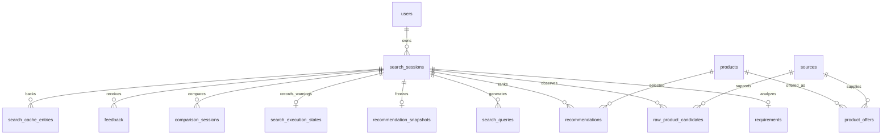

# Database

MVP dùng **SQLite + SQLAlchemy 2**, không cần PostgreSQL hoặc Redis. Bảng được
đăng ký qua `app/models/__init__.py`; FastAPI lifespan gọi `init_db()`/`create_all()`
để tạo bảng còn thiếu. Không có migration/backfill database thật trong Phase 7.

## 14 bảng thực tế

| Bảng | Trường chính và vai trò |
|---|---|
| `users` | `id`, `created_at`; nền cho quan hệ user, chưa có authentication/profile |
| `search_sessions` | UUID `id`, nullable `user_id`, `raw_query`, `status`, `created_at`, `completed_at`, `processing_time_ms` |
| `requirements` | `id`, unique `session_id`, category/budget_min/budget_max/currency, JSON purpose/brands/requirements/excluded_requirements, sort_preference/confidence/created_at |
| `search_queries` | `id`, `session_id`, query, position, created_at |
| `sources` | `id`, unique URL, domain/title, reliability_score, retrieved_at |
| `raw_product_candidates` | `id`, session_id, nullable source_id, search_query, JSON payload, created_at; observation của mỗi session |
| `products` | `id`, name/category/brand/model/normalized_name/image_url, rating/review_count, JSON specifications/pros/cons, created_at/updated_at |
| `product_offers` | `id`, product_id, merchant, price/currency/availability, nullable source_id, product_url, last_checked_at |
| `recommendations` | `id`, session_id/product_id, final_score và sáu component scores, confidence/rank, JSON explanation, created_at; unique cặp session/product |
| `recommendation_snapshots` | PK/FK session_id, JSON payload, created_at; payload version 1 lưu full RecommendationRunResult |
| `comparison_sessions` | `id`, session_id, JSON product_ids/result, created_at; result đóng băng lúc tạo comparison |
| `feedback` | `id`, session_id, nullable product_id, is_helpful, reason/comment, created_at |
| `search_execution_states` | PK/FK session_id, JSON warnings; trạng thái lỗi nằm ở SearchSession, warnings của lần thử mới nhất nằm ở đây |
| `search_cache_entries` | SHA-256 PK key, source session_id, snapshot_created_at, created_at/expires_at; tham chiếu snapshot còn hợp lệ |

## Quan hệ

Product ID là định danh nội bộ, không đảm bảo giữ nguyên giữa các database. Source
có thể dùng chung qua nhiều session; không được coi Source hiện tại là evidence
mới của mọi snapshot. Offer giữ giá theo nguồn; không gộp giá merchant vào Product.
Raw observations vẫn giữ session_id để đối chiếu provenance.

## Snapshot và lịch sử

Snapshot version 1 có `result.requirement`, candidates, filter_decisions,
recommendations, total_found/total_filtered, data_semantics/data_mode. Mỗi item chứa
price/rating/reviews/specifications/score/confidence, explanation, requirement_matches
và evidence.fields. Không có cột SQL mới cho metadata Phase 6.

GET đọc snapshot đã lưu, không join catalog để cập nhật các field đó. Giá có thể
khác offer hiện tại nhưng score/evidence vẫn nhất quán. Snapshot cũ thiếu metadata
mới đọc thành arrays rỗng; legacy trước snapshot được tính lại toàn bộ chỉ đọc và
ghi nhãn `legacy_recomputed`. Không coi view legacy là lịch sử đã khôi phục chính xác.

Rerun thành công thay snapshot của session đó, không lưu nhiều version. Rerun search
fail toàn bộ giữ snapshot cũ nhưng session FAILED và warnings mới. History trả cả
hai để phân biệt kết quả thành công gần nhất và lỗi lần thử mới nhất.

Comparison mới dựa cùng recommendation view, sau đó giữ JSON result riêng. Các
comparison đã lưu từ trước Phase 7 không sửa/backfill; chúng vẫn phản ánh semantics
cũ lúc tạo. Feedback là dữ liệu đánh giá, chưa dùng để tự điều chỉnh scoring weights.

## SQLite và vận hành

- Local chạy từ `backend/`: `sqlite:///./smart_shopping.db`.
- Docker: `sqlite:////data/smart_shopping.db`, volume `shopping-data`, tách DB local.
- Pytest/E2E: database tạm riêng, không dùng hai đường dẫn trên.
- Connection bật foreign_keys, WAL, busy_timeout 30000ms, synchronous NORMAL;
  `check_same_thread=False`, transaction do caller commit/rollback.
- SQLite phù hợp MVP local; không coi đây là thiết kế multi-writer tải cao.
- `create_all()` tạo bảng còn thiếu, không migrate schema của bảng đã tồn tại.
  Backup trước mọi migration tương lai. Không xóa DB để xử lý lỗi schema.
- Để backup local đơn giản, dừng backend rồi copy DB cùng các file WAL/SHM nếu còn;
  không copy một file DB đang ghi và coi đó là backup đầy đủ. Có thể dùng SQLite
  backup API khi xây công cụ backup riêng.
- `docker compose down` giữ named volume; không dùng `down -v` nếu cần dữ liệu.
- History dùng bảng hiện có, không có bảng history riêng. Cache hết TTL bị bỏ qua,
  chưa có job dọn định kỳ các row cũ.

Xem [architecture](architecture.md), [API](api.md), [testing](testing.md).
